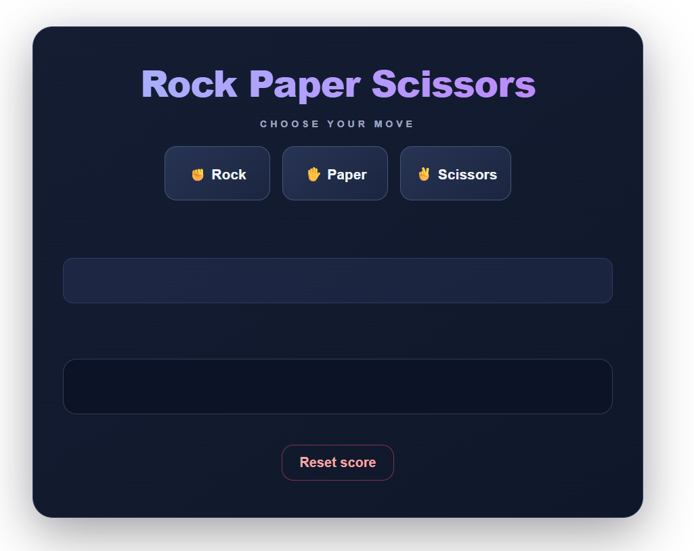
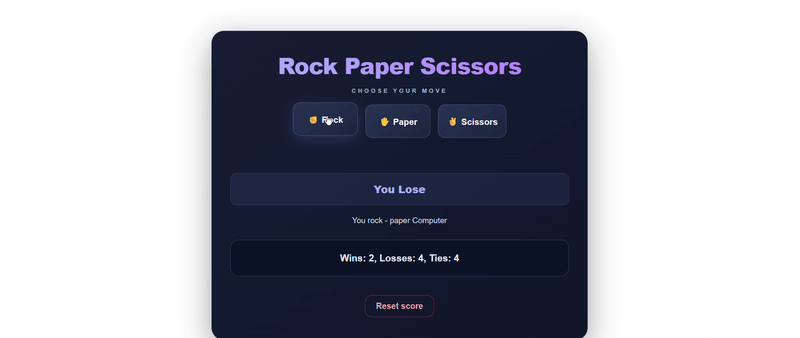

<div align="center">

# ✊ Rock Paper Scissors ✋

<p align="center">
  <strong>A classic game built with HTML, CSS, and JavaScript.</strong>
  <br>
  Play against the computer, track your score, and keep your progress saved between visits.
</p>

<!-- 1. Logo or Banner -->

<p align="center">
  
</p>

<!-- 2. Badges -->

<p align="center">
  
  
  
  
</p>
</div>

<!-- 3. Short Project Introduction -->

## 📸 Preview
LIIIIIIINK



<br>



## 🎮 About the Project

I built this Rock Paper Scissors game as a hands-on JavaScript project to practice programming fundamentals and DOM manipulation.

The game allows players to compete against a computer, see the result of each round, and track their wins, losses, and ties. The score is saved in the browser using `localStorage`, so it remains available after refreshing the page.

## 🕹️ Features

- **Interactive Gameplay:** Choose Rock, Paper, or Scissors to play against the computer.
- **Random Computer Moves:** The computer selects a move using `Math.random()`.
- **Automatic Results:** The game determines whether you win, lose, or tie.
- **Score Tracking:** Keeps track of wins, losses, and ties.
- **Persistent Storage:** Saves the score in `localStorage` so it survives page refreshes.
- **Reset Functionality:** Reset the score and start a new game.
- **Responsive Design:** A modern gaming interface designed to work on different screen sizes.


<p align="center">
  
</p>

## ⚙️ How It Works

1. The player selects Rock, Paper, or Scissors.
2. The computer randomly chooses its move.
3. The game compares both moves using `if...else` statements.
4. The result is displayed on the page.
5. The score is updated and saved in `localStorage`.
6. When the page is refreshed, the previously saved score is loaded again.


## 🚀 Installation and Usage

### Prerequisites

- A web browser such as Chrome, Firefox, or Edge.
- Git installed on your computer (optional).
- A code editor such as Visual Studio Code (optional).

### Option 1: Clone the Repository

Open PowerShell or your terminal and run:

```bash
git clone https://github.com/Elmahdi25/rock-paper-scissors.git
```

Navigate to the project folder:

```bash
cd rock-paper-scissors
```

Open `index.html` in your browser to start playing.

> Replace the repository URL above if your GitHub username or repository name is different.

### Option 2: Download the Project

1. Open the repository on GitHub.
2. Click **Code → Download ZIP**.
3. Extract the downloaded folder.
4. Open `index.html` in your browser.

### How to Play

- Click **Rock**, **Paper**, or **Scissors** to play a round.
- Check the result and updated score on the page.
- Click **Reset Score** to clear your current score.


## 🧠 JavaScript Concepts Practiced

This project helped me understand and apply the following JavaScript concepts:

| Concept                             | How I Used It                                                                                        |
| ----------------------------------- | ---------------------------------------------------------------------------------------------------- |
| Variables (`let` and `const`)       | Store the player's move, computer's move, result, and score.                                         |
| Objects                             | Represent the score using `wins`, `losses`, and `ties` properties.                                   |
| Functions                           | Organize the game logic into `play()`, `pick_robot_move()`, `update_score_element()`, and `reset()`. |
| Parameters and return values        | Pass the player's move into `play()` and return the computer's move from `pick_robot_move()`.        |
| Conditional statements              | Use `if...else if...else` to determine the winner.                                                   |
| Comparison operators                | Compare moves and check the game result.                                                             |
| Logical operators                   | Use conditions such as `&&` to check ranges of random numbers.                                       |
| Arithmetic and assignment operators | Increment the score using `++` and work with fractional ranges.                                      |
| `Math.random()`                     | Generate a random number to select the computer's move.                                              |
| DOM manipulation                    | Update HTML elements using `document.querySelector()` and `innerHTML`.                               |
| Template literals                   | Display dynamic results, moves, and scores using backticks and `${...}`.                             |
| JSON                                | Convert the score object into a string using `JSON.stringify()` and restore it using `JSON.parse()`. |
| `localStorage`                      | Save and retrieve the score between browser sessions.                                                |
| `null` and truthy/falsy values      | Check whether a saved score exists and initialize a default score when it does not.                  |

## 💡 A Key Learning Experience

One of the most important parts of this project was learning how to save and restore a JavaScript object using `localStorage`.

Since `localStorage` stores values as strings, I needed to convert the score object into JSON before saving it and parse the stored JSON when loading it again.

```javascript
// Save the score
localStorage.setItem("score", JSON.stringify(score));

// Load the score
let get_score = localStorage.getItem("score");
let js_score_object = JSON.parse(get_score);
```

This helped me understand the difference between a JavaScript object and a string, as well as how browser storage can make an application remember data after a page refresh.

## 🛠️ Technologies

- **HTML5** — Game structure and buttons.
- **CSS3** — Styling, layout, hover effects, and responsive design.
- **JavaScript** — Game logic, random moves, score tracking, and browser storage.

## 🔮 Possible Future Improvements

- Add sound effects and animations.
- Display icons for each move.
- Highlight wins, losses, and ties with different colors.
- Add a round history.
- Improve accessibility and keyboard controls.

## 👨‍💻 Author

**Elmahdi Benabbou**

- GitHub: [@Elmahdi25](https://github.com/Elmahdi25)
- Portfolio: [View My Portfolio](https://elmahdi25.github.io/RESUME/index.html)

---

<div align="center">
<p><strong>From small exercises to interactive projects — growing my JavaScript skills step by step. ⚡</strong></p>
</div>