<div align="center">

# ⚡ JavaScript Learning Journey

**Small exercises. New concepts. One step closer to building interactive websites.**


My practice repository as I learn JavaScript with **SuperSimpleDev**, following my HTML and CSS studies.

[Explore the lessons](#what-i-learned) · [Try it yourself](#how-to-use) · [Meet the author](https://github.com/Elmahdi25)

</div>

---

## About this repository

This is where I practice JavaScript, experiment with examples, and document what I understand along the way. My goal is to move from writing simple instructions to building interactive websites and solving problems independently.


This repository is a learning journal that will grow as I continue the course.

## Chapter index

| Chapter | Topic | Status |
| --- | --- | --- |
| [01](#chapter-01--javascript-basics) | JavaScript Basics | Covered |
| [02](#chapter-02--numbers--math) | Numbers & Math | Covered |
| [03](#chapter-03--strings) | Strings | Covered |
| [04](#chapter-04--html-css--javascript) | HTML, CSS & JavaScript | Covered |
| [05](#chapter-05--variables) | Variables | Covered |
| [06](#chapter-06--booleans--if-statements) | Booleans & If Statements | Covered |

Each chapter uses a stable two-digit number. Subsections use the same prefix, such as **03.1**, so new lessons can be added without renumbering earlier chapters.

## Preview

From my first popup to calculating a shopping total:

```js
alert('Hello!');

// Calculate prices in cents, then convert to dollars.
console.log((2095 + 799) / 100); // 28.94

// Round tax to the nearest cent before converting.
console.log(Math.round((2095 + 799) * 0.1) / 100); // 2.89
```

## Tools I use

| Tool | Purpose |
| --- | --- |
| JavaScript | Instructions, calculations, and page changes |
| HTML | The page that loads my JavaScript |
| VS Code | Writing and organizing my files |
| Browser DevTools | Trying expressions and checking errors |
| Git & GitHub | Tracking changes and sharing my progress |

## Project structure

| File | Purpose |
| --- | --- |
| `index.html` | Entry page that loads the JavaScript file |
| `basics.js` | JavaScript practice and experiments |
| `3_strings/exersices.js` | String exercises (current local chapter file) |
| `README.md` | Learning notes and progress |

## How to use

1. Download the repository, or clone it using its GitHub **Code** button.
2. Open the project folder in VS Code.
3. Open `index.html` in a browser.
4. Press **F12** and select **Console** to inspect output and errors.
5. Edit the JavaScript file loaded by the page, save it, and refresh to try your changes.

No package installation is needed for these browser-based exercises.

To load the script after the HTML has been parsed, use this inside `<head>`:

```html
<script src="basics.js" defer></script>
```

## What I learned

## Chapter 01 — JavaScript Basics

### 01.1 Code, syntax, and the console

- **Code** is a set of instructions that a computer follows.
- **Running code** means executing those instructions.
- **Syntax** is the set of rules for writing valid code.
- JavaScript is **case-sensitive**: `innerHTML` and `innerHtml` are different names.
- The browser console lets me test small pieces of JavaScript immediately.

```js
alert('Hello');
alert('Good job!');
```

### 01.2 Changing a web page

```js
document.body.innerHTML = 'Hello';
```

This replaces the content inside the page's `<body>` with `Hello`. The body must exist before this instruction runs.

## Chapter 02 — Numbers & Math

### 02.1 Numbers and arithmetic

```js
2 + 2;  // 4 — addition
10 - 3; // 7 — subtraction
3 * 4;  // 12 — multiplication
10 / 2; // 5 — division
```

I learned the difference between **integers**, such as `2`, and **floating-point numbers**, such as `2.8`.

### 02.2 Order of operations

Multiplication and division happen before addition and subtraction. Parentheses let me control which calculation happens first.

```js
2 + 3 * 4;   // 14
(2 + 3) * 4; // 20
```

### 02.3 Calculating money

Some decimal numbers cannot be represented exactly by the computer:

```js
0.1 + 0.2; // 0.30000000000000004
```

For these shopping exercises, I calculate prices using integer cents and convert to dollars at the end.

```js
(2095 + 799) / 100; // 28.94
```

For a 10% tax, I round the calculated cents before converting:

```js
Math.round((2095 + 799) * 0.1) / 100; // 2.89
```

### 02.4 Rounding numbers

The course introduced `Math.round()`. I also explored rounding up, rounding down, and removing the decimal part.

| Method | Meaning | Example | Result |
| --- | --- | --- | --- |
| `Math.round()` | Round to the nearest integer | `Math.round(2.8)` | `3` |
| `Math.floor()` | Round down | `Math.floor(2.8)` | `2` |
| `Math.ceil()` | Round up | `Math.ceil(2.1)` | `3` |
| `Math.trunc()` | Remove the decimal part | `Math.trunc(2.8)` | `2` |

Negative numbers helped me understand the difference:

```js
Math.floor(-2.8); // -3
Math.ceil(-2.8);  // -2
Math.trunc(-2.8); // -2
```

### 02.5 Learning to find answers

I am practicing how to describe a problem clearly, search for the JavaScript feature I need, and test an example before using it. Understanding why the code works is part of the exercise.

## Chapter 03 — Strings

### 03.1 What is a string?

A **string** represents text. Numbers and strings are different value types.

```js
'Hello';
'123'; // A string, even though it contains digits.
123;   // A number.

typeof 'Hello'; // "string"
typeof 123;     // "number"
```

### 03.2 Concatenation

**Concatenation** means joining strings with `+`. Spaces must be included explicitly.

```js
'some' + 'text';           // "sometext"
'some' + ' ' + 'text';     // "some text"
'some' + ' more' + ' text'; // "some more text"
```

### 03.3 Strings, numbers, and type coercion

With a string operand, `+` joins text instead of adding numbers. JavaScript automatically converts the other number to a string: this is **type coercion**.

```js
'Hello ' + 3; // "Hello 3"
2 + 3;       // 5
'2' + 3;     // "23"
```

Addition and concatenation are evaluated from left to right:

```js
'$' + 5 + 3; // "$53"
5 + 3 + '$'; // "8$"
```

### 03.4 Parentheses before concatenation

Expressions involving strings follow the same order of operations. Expressions inside parentheses are evaluated first.

```js
'$' + (5 + 3); // "$8"

// Calculate in cents, then join the result to the text.
'$' + (2095 + 799) / 100; // "$28.94"

'Items (' + (1 + 1) + '): $' + (2095 + 799) / 100;
// "Items (2): $28.94"
```

### 03.5 Three ways to write strings

```js
'Hello'; // Single quotes.
"Hello"; // Double quotes.
`Hello`; // Backticks: a template literal (template string).
```

I use single quotes for simple text, double quotes when convenient for an apostrophe, and backticks for interpolation or multiline text.

```js
"I'm learning JavaScript";
```

### 03.6 Escape sequences

A backslash introduces an **escape sequence**. It lets me include special characters without ending the string.

| Sequence | Meaning |
| --- | --- |
| `\'` | Single quote |
| `\"` | Double quote |
| `\n` | New line |
| `\\` | Backslash |

```js
'I\'m learning JavaScript';
"He said: \"Hello!\"";
console.log('Hello\nJavaScript');
```

The last example prints:

```text
Hello
JavaScript
```

### 03.7 Template literals and interpolation

Backticks let me insert an expression directly into a string using `${...}`. This is **interpolation**.

```js
`Total cost: $${5 + 3}`; // "Total cost: $8"

`Items (${1 + 1}): $${(2095 + 799) / 100}`;
// "Items (2): $28.94"
```

In `$${5 + 3}`, the first `$` is ordinary text for the currency sign. The second `$` starts the `${...}` expression.

### 03.8 Multiline strings

Template literals can contain actual line breaks:

```js
console.log(`Hello
JavaScript`);
```

This prints two lines, just like `'Hello\nJavaScript'`.

### 03.9 Displaying strings: browser vs terminal

`alert()` creates a browser popup. It is not available in Node.js. `console.log()` works in both environments.

```js
// Browser popup:
alert(`Total cost: $${5 + 3}`);

// Browser console or Node.js terminal:
console.log(`Total cost: $${5 + 3}`);
```

### 03.10 Extra practice: two decimal places

I also explored `.toFixed(2)` to format prices. It rounds to two decimal places and returns a **string**.

```js
(6.786).toFixed(2); // "6.79"
(2.8).toFixed(2);   // "2.80"

`Total cost: $${((2095 + 799) / 100).toFixed(2)}`;
// "Total cost: $28.94"

Number((6.786).toFixed(2)); // 6.79 (a number)
```

Floating-point representation can affect rounding at some boundaries. For these money exercises, I keep calculations in cents and format the result for display at the end.

### 03.11 Chapter recap

- A string represents text; `typeof` identifies its type.
- `+` can add numbers or concatenate strings.
- Parentheses help calculate numbers before joining them to text.
- Single quotes, double quotes, and backticks create strings.
- Escape sequences represent quotes, line breaks, and backslashes.
- Template literals support interpolation and multiline text.
- `.toFixed(2)` returns rounded text with two decimal places.

## Problems I worked through

| Problem | What I learned |
| --- | --- |
| `Cannot set properties of null` when changing the body | Run the script after the body exists, using `defer` or placing the script before `</body>`. |
| `removeChild` reports that a node is not a child | The node must be a direct child of that parent; replacing `innerHTML` can also remove existing nodes. |
| Unexpected decimal results | Use integer cents for the price calculations in these exercises. |
| `alert is not defined` in the VS Code terminal | Node.js does not provide browser popups; use `console.log()` or run the script in a browser. |
| Getting `"$53"` instead of `"$8"` | Calculate with parentheses or interpolate the numeric expression in a template literal. |
| An apostrophe ends a string early | Use double quotes or escape the apostrophe with a backslash. |
| Choosing a rounding method | Decide whether I need the nearest integer, rounding down, rounding up, or truncation. |

## Next improvements

- [ ] Add Chapter 04 after completing the next lesson.
- [ ] Add more exercises and organize them by topic.
- [ ] Learn variables, conditions, functions, and loops.
- [ ] Practice targeting individual page elements.
- [ ] Build small interactive projects as I progress.

### Screenshots from exercises

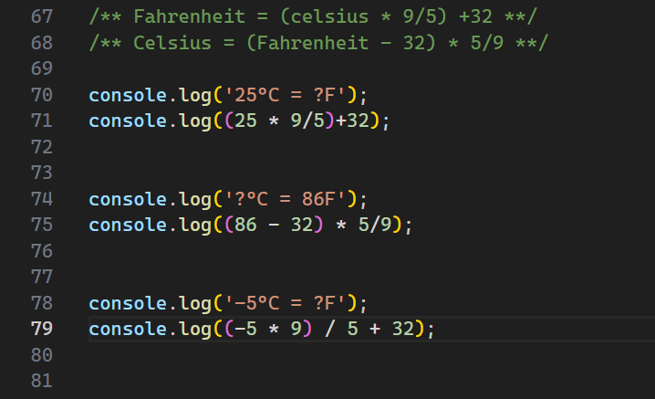

<br>

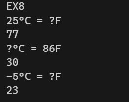

<br>

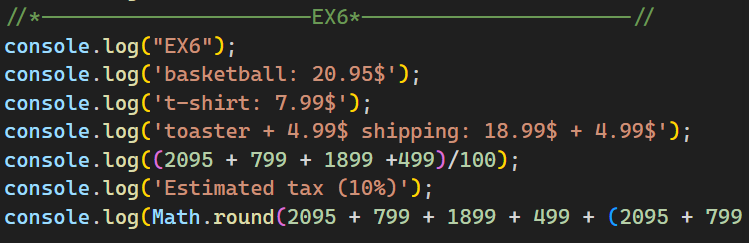

<br>

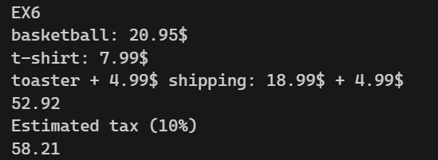

<br>

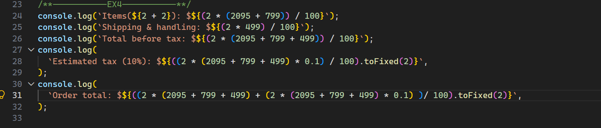

<br>

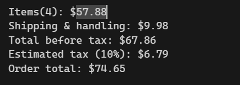

<br>

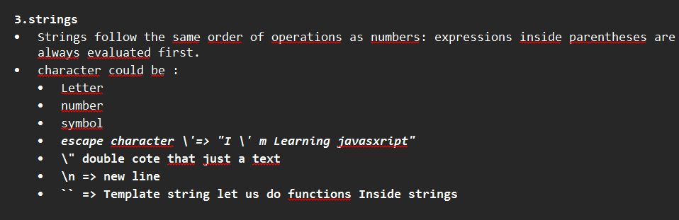


## Chapter 04 — HTML, CSS & JavaScript

### 04.1 How the three languages work together

| Language | Role |
| --- | --- |
| HTML | Creates the page structure and elements |
| CSS | Controls their appearance and layout |
| JavaScript | Adds behavior and interactivity |

HTML connects the page to its CSS and JavaScript.

### 04.2 JavaScript inside HTML

The `<script>` element lets me write JavaScript directly inside an HTML file.

```html
<body>
  <button>Click me</button>

  <script>
    alert('Hello!');
  </script>
</body>
```

This script runs when the browser reaches it while loading the page.

Placing it just before `</body>` means the HTML elements above it already exist when the JavaScript runs.

### 04.3 Using a separate JavaScript file

I can keep the three languages in separate files:

| File | Purpose |
| --- | --- |
| `index.html` | Page structure |
| `style.css` | Styling |
| `script.js` | JavaScript behavior |

Inside the HTML `<head>`:

```html
<link rel="stylesheet" href="style.css">
<script src="script.js" defer></script>
```

`defer` tells the browser to run the external script after it has parsed the HTML—after reading it and creating its elements.

Alternatively, I can load the script just before `</body>`:

```html
<script src="script.js"></script>
```

### 04.4 Running code when a button is clicked

The `onclick` attribute runs JavaScript when the user clicks an element.

```html
<button onclick="alert('Good job!');">
  Click me
</button>
```

The outer double quotes contain the JavaScript code. The inner single quotes contain the message.

| Location | When the code runs |
| --- | --- |
| A regular `<script>` element | When the browser reaches the script |
| An external script with `defer` | After the HTML has been parsed |
| An `onclick` handler | Each time the element is clicked |

### 04.5 Keeping the click behavior in script.js

I also practiced attaching the click behavior from a separate JavaScript file.

**HTML:**

```html
<button id="hello-button">Click me</button>
```

**JavaScript:**

```js
document.querySelector('#hello-button').onclick = function () {
  alert('Good job!');
};
```

- `querySelector('#hello-button')` finds the element with that ID.
- `.onclick` assigns its click handler.
- The function body runs when the button is clicked.

The button must exist before this code runs, so I use `defer` or load the script at the bottom of the body.

### 04.6 Comments

Comments explain code to people. They are not executed.

**JavaScript:**

```js
// A single-line comment.

/*
  A comment that
  spans several lines.
*/
```

**HTML:**

```html
<!-- An HTML comment. -->
```

**CSS:**

```css
/* A CSS comment. */
```

I can also temporarily disable a line by commenting it out:

```js
// alert('Hello!');
```

Comments remain part of the source file and appear on GitHub when committed and pushed.

### 04.7 Displaying results with console.log()

An expression inside a script is evaluated, but its result is not automatically displayed.

```js
2 + 2; // Calculated, but no visible output.
```

To inspect the result, I use `console.log()`:

```js
console.log(2 + 2);              // 4
console.log('some' + ' text');   // "some text"
console.log(`Total: $${5 + 3}`); // "Total: $8"
```

I open the browser’s DevTools with **F12**, then select **Console** to see the output.

`console.log()` writes to the console; it does not add text to the web page.

### 04.8 Chapter recap

- HTML creates structure, CSS adds styling, and JavaScript adds behavior.
- `<script>` runs JavaScript inside HTML.
- `src` loads JavaScript from a separate file.
- `defer` lets the HTML be parsed before an external script runs.
- `onclick` runs code when an element is clicked.
- Comments explain or temporarily disable code.
- `console.log()` helps inspect results and debug code.


<br>

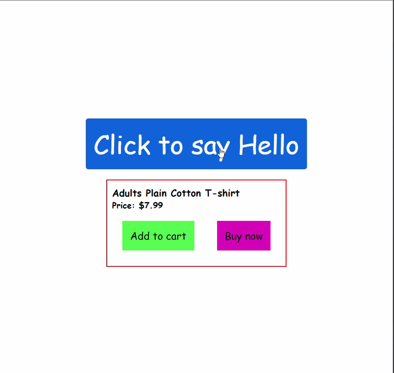


## Chapter 05 — Variables

### 05.1 Saving and using values

A **variable** is a named place to store a value so I can use it later.

```js
let cartQuantity = 0;
console.log(cartQuantity); // 0
```

- `let` declares the variable.
- `cartQuantity` is its name.
- `=` assigns a value.
- `0` is the initial value.

Without quotes, JavaScript reads the variable's value. With quotes, it reads ordinary text:

```js
console.log(cartQuantity);   // 0
console.log('cartQuantity'); // "cartQuantity"
```

### 05.2 Storing calculation results

A variable can store a number, a string, or the result of an expression.

```js
const calculation = 2 + 2;
const result = calculation + 2;
const message = 'Hello';

console.log(calculation); // 4
console.log(result);      // 6
console.log(message);     // "Hello"
```

The expression on the right is evaluated first, then its result is stored.

A calculation is not automatically repeated when another variable changes:

```js
let price = 5;
const total = price + 3; // Stores 8.

price = 10;
console.log(total); // Still 8.
```

### 05.3 Reassigning a variable

**Reassignment** replaces a variable's current value.

```js
let quantity = 3;
console.log(quantity); // 3

quantity = 5;
console.log(quantity); // 5
```

I declare the variable with `let` once. To update it, I use its name without repeating `let`.

`=` means **assign**, not “check whether two values are equal.”

### 05.4 Updating a value using itself

```js
let cartQuantity = 0;

cartQuantity = cartQuantity + 1;
console.log(cartQuantity); // 1
```

JavaScript:

1. Reads the current value: `0`.
2. Adds `1`.
3. Stores the result back in `cartQuantity`.

Simply calculating `cartQuantity + 1` does not update the variable. The result must be assigned back.

### 05.5 Assignment shortcuts

For a numeric variable, these shortcuts make updates shorter:

| Shortcut | Equivalent |
| --- | --- |
| `quantity += 2;` | `quantity = quantity + 2;` |
| `quantity -= 2;` | `quantity = quantity - 2;` |
| `quantity *= 2;` | `quantity = quantity * 2;` |
| `quantity /= 2;` | `quantity = quantity / 2;` |
| `quantity++;` | Increase by 1 |
| `quantity--;` | Decrease by 1 |

For example:

```js
let quantity = 0;

quantity++;    // 1
quantity += 2; // 3
quantity--;    // 2
quantity = 0; // Reset to 0.
```

### 05.6 Choosing const, let, or var

| Keyword | Can be reassigned? | When I use it |
| --- | --- | --- |
| `const` | No | Default choice when reassignment is unnecessary |
| `let` | Yes | When the value needs to change |
| `var` | Yes | Older code; prefer `const` or `let` in new code |

```js
const message = 'Welcome!';
let cartQuantity = 0;

cartQuantity += 1; // Works.
// message = 'Hello'; // Would cause an error.
```

A `const` declaration needs an initial value.

`const` prevents **reassignment**. Later, when working with objects and arrays, their contents can still change.

### 05.7 Naming variables clearly

I use **camelCase**: the first word starts lowercase, and each following word starts uppercase.

```js
let cartQuantity = 0;
const totalPrice = 28.94;
const welcomeMessage = 'Hello!';
```

Essential naming rules:

- Names cannot start with a digit.
- Names cannot contain spaces or hyphens.
- Reserved keywords such as `let` cannot be used as names.
- Letters, digits after the first character, `_`, and `$` are allowed.
- Names are case-sensitive: `cartQuantity` and `cartquantity` are different.

| Style | Example | Typical use |
| --- | --- | --- |
| camelCase | `cartQuantity` | JavaScript variables |
| PascalCase | `CartQuantity` | JavaScript classes, covered later |
| kebab-case | `cart-quantity` | File names and CSS classes; invalid as a variable name |
| snake_case | `cart_quantity` | Valid in JavaScript, but not my default style |

I choose names that explain their purpose without becoming unnecessarily long.

### 05.8 Variables inside strings and typeof

Template literals let me display a variable's current value:

```js
let cartQuantity = 3;

console.log(`Cart quantity: ${cartQuantity}`);
// "Cart quantity: 3"
```

`typeof` identifies the type of the value currently stored:

```js
const quantity = 3;
const message = 'Hello';

console.log(typeof quantity); // "number"
console.log(typeof message);  // "string"
```

### 05.9 Mini project: cart quantity

This example connects variables to button clicks. Results appear in the browser console.

```html
<button onclick="console.log(`Cart quantity: ${cartQuantity}`);">
  Show quantity
</button>

<button onclick="
  cartQuantity++;
  console.log(`Cart quantity: ${cartQuantity}`);
">
  Add to cart
</button>

<button onclick="
  cartQuantity += 2;
  console.log(`Cart quantity: ${cartQuantity}`);
">
  +2
</button>

<button onclick="
  cartQuantity += 3;
  console.log(`Cart quantity: ${cartQuantity}`);
">
  +3
</button>

<button onclick="
  cartQuantity = 0;
  console.log('Cart was reset.');
  console.log(`Cart quantity: ${cartQuantity}`);
">
  Reset cart
</button>

<script>
  let cartQuantity = 0;
</script>
```

The variable stores the current quantity between clicks. Each button reads or updates that same variable.

Refreshing the page runs the script again and resets the quantity to `0`. Saving values between page visits is a separate topic.

### 05.10 Semicolons

A semicolon ends a JavaScript statement:

```js
const message = 'Hello';
console.log(message);
```

JavaScript can automatically insert semicolons in some situations. I use them consistently in these exercises to make statement boundaries clear.

### 05.11 Chapter recap

- Variables store values for later use.
- Expressions are evaluated before their results are assigned.
- Reassignment updates an existing variable without declaring it again.
- `+=`, `-=`, `*=`, `/=`, `++`, and `--` simplify updates.
- I use `const` by default and `let` when reassignment is needed.
- Clear camelCase names make code easier to understand.
- Template literals display variable values; `typeof` checks their types.
- Variables let interactive features remember their current state between actions.


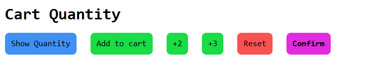

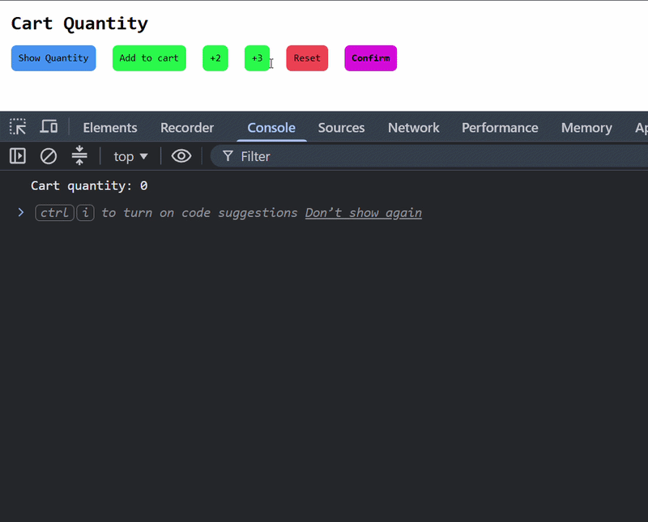


## Chapter 06 — Booleans & If Statements

### 06.1 Boolean values

A **boolean** represents whether something is true or false. It has only two possible values: `true` and `false`.

```js
console.log(3 < 5); // true
console.log(3 > 5); // false

console.log(typeof true);   // "boolean"
console.log(typeof 'true'); // "string"
```

Booleans do not use quotes. `'false'` is text, not the boolean `false`.

### 06.2 Comparison operators

Comparisons produce a boolean result.

| Operator | Meaning | Example | Result |
| --- | --- | --- | --- |
| `>` | Greater than | `5 > 3` | `true` |
| `<` | Less than | `5 < 3` | `false` |
| `>=` | Greater than or equal to | `5 >= 5` | `true` |
| `<=` | Less than or equal to | `3 <= 5` | `true` |
| `===` | Strict equality | `5 === '5'` | `false` |
| `!==` | Strict inequality | `5 !== '5'` | `true` |

I use `===` and `!==` by default because they do not automatically convert different value types.

```js
5 == '5';  // true — type conversion.
5 === '5'; // false — different types.
```

`=` assigns a value; `===` compares values.

Arithmetic is evaluated before comparisons:

```js
3 > 5 - 5; // true, because 3 > 0.
```

### 06.3 Making decisions with if, else if, and else

An `if` statement runs a block of code when its condition is truthy.

```js
const cartQuantity = 3;

if (cartQuantity > 0) {
  console.log('The cart has products.');
} else {
  console.log('The cart is empty.');
}
```

`else if` adds another condition:

```js
const score = 75;

if (score >= 80) {
  console.log('Excellent!');
} else if (score >= 50) {
  console.log('Passed.');
} else {
  console.log('Try again.');
}
```

Conditions are checked from top to bottom. **Only the first matching branch runs.** If none match, the optional `else` branch runs.

I keep curly braces `{}` around each branch to make the code clear.

### 06.4 Logical operators

Logical operators combine or reverse conditions.

| Operator | Meaning with boolean conditions |
| --- | --- |
| `&&` | AND: both conditions must be true |
| `\|\|` | OR: at least one condition must be true |
| `!` | NOT: reverses true and false |

```js
const quantity = 5;

console.log(quantity > 0 && quantity <= 10); // true
console.log(quantity === 0 || quantity === 5); // true
console.log(!(quantity > 0)); // false
```

To check a range, I compare both boundaries explicitly:

```js
quantity > 0 && quantity <= 10;
```

I do not write `0 < quantity <= 10`, because JavaScript does not interpret it as a mathematical range.

### 06.5 Random numbers and algorithms

`Math.random()` produces a number greater than or equal to `0` and less than `1`.

I can divide that range into three parts to choose a computer move:

```js
const randomNumber = Math.random();
let computerMove = '';

if (randomNumber < 1 / 3) {
  computerMove = 'rock';
} else if (randomNumber < 2 / 3) {
  computerMove = 'paper';
} else {
  computerMove = 'scissors';
}

console.log(computerMove);
```

The second branch is reached only when the first condition is false, so it already excludes numbers below `1 / 3`.

An **algorithm** is a sequence of steps for solving a problem. For Rock Paper Scissors:

1. Read the player's move.
2. Generate the computer's move.
3. Compare the moves.
4. Display the result.

Example for a player who chooses rock:

```js
let result = '';

if (computerMove === 'rock') {
  result = 'Tie.';
} else if (computerMove === 'paper') {
  result = 'You lose.';
} else {
  result = 'You win.';
}

console.log(`You picked rock. Computer picked ${computerMove}. ${result}`);
```

### 06.6 Truthy and falsy values

Conditions can use values other than booleans.

- **Truthy** values behave like `true` in a condition.
- **Falsy** values behave like `false` in a condition.

Common falsy values are:

| Value | Meaning |
| --- | --- |
| `false` | Boolean false |
| `0` | Zero |
| `''` | Empty string |
| `NaN` | An invalid numeric result |
| `undefined` | Often a value that has not been assigned |
| `null` | Intentional absence of a value |

`-0` and the BigInt value `0n` are also falsy.

```js
if (5) {
  console.log('Runs.');
}

if (0) {
  console.log('Does not run.');
}
```

Nonempty strings and negative numbers are truthy:

```js
console.log(Boolean('false')); // true
console.log(Boolean('0'));     // true
console.log(Boolean(-1));      // true
```

For quantities, `cartQuantity > 0` expresses the intention more clearly than simply checking `cartQuantity`, especially if negative values are possible.

### 06.7 NaN and undefined

`NaN` means “Not a Number.” It can result from an invalid numeric calculation.

```js
console.log('Hello' / 5); // NaN
```

A variable declared with `let` without an initial value contains `undefined`:

```js
let message;
console.log(message); // undefined
```

A `const` declaration must have an initial value.

### 06.8 Ternary operator

The **ternary operator** selects one of two values:

```js
condition ? valueIfTruthy : valueIfFalsy;
```

It is useful for assigning a simple conditional result:

```js
const quantity = 3;
const message = quantity > 0 ? 'Cart has products.' : 'Cart is empty.';

console.log(message); // "Cart has products."
```

For several actions or complicated conditions, an `if` statement is easier to read.

### 06.9 Short-circuit evaluation

`&&` and `||` can stop before evaluating their right-hand side.

**AND (`&&`):** if the left value is falsy, it returns that value immediately. Otherwise, it evaluates and returns the right value.

```js
false && console.log('Hello'); // Does not print.
true && console.log('Hello');  // Prints "Hello".

console.log(0 && 'Hello'); // 0
console.log(5 && 'Hello'); // "Hello"
```

This can act as a **guard** that allows code to run only when a condition is truthy.

**OR (`||`):** if the left value is truthy, it returns that value immediately. Otherwise, it evaluates and returns the right value.

```js
const selectedCurrency = '';
const currency = selectedCurrency || 'USD';

console.log(currency); // "USD"
console.log('EUR' || 'USD'); // "EUR"
```

This can provide a **default value**. However, it replaces every falsy value, including `0`, `false`, and `''`.

`&&` and `||` return operand values—not necessarily booleans.

### 06.10 Chapter recap

- Booleans are `true` or `false`, without quotes.
- Comparisons produce boolean results.
- `===` and `!==` avoid automatic type conversion.
- `if`, `else if`, and `else` select which branch runs.
- `&&`, `||`, and `!` combine or reverse conditions.
- `Math.random()` helps generate random choices.
- Algorithms turn a problem into clear steps.
- Truthy and falsy values determine how conditions behave.
- Ternary expressions choose values; short-circuit operators can guard code or provide defaults.

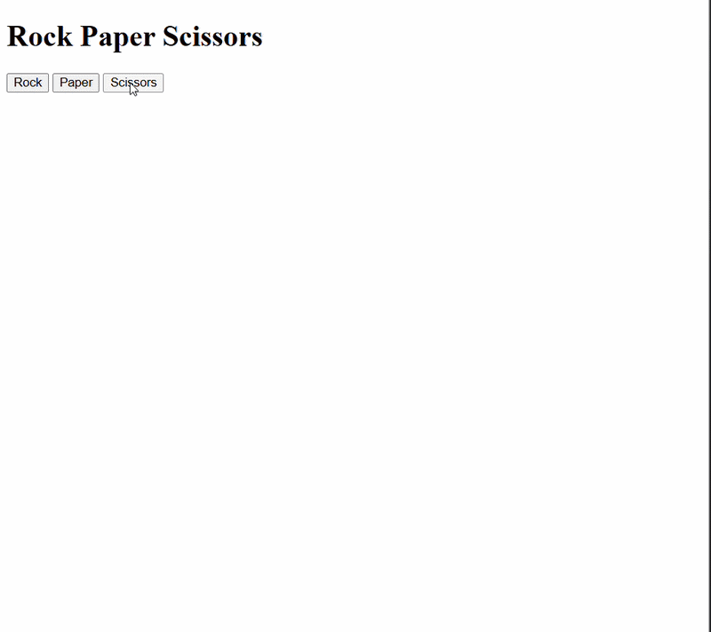

## Feedback and contributions

This is a personal learning repository. Suggestions, clear explanations, and feedback are welcome through GitHub issues. I want to understand improvements and practice applying them myself.

## Credits and license

Learning journal by **[Elmahdi Benabbou](https://github.com/Elmahdi25)**, following the JavaScript course by **Simon from [SuperSimple.dev](https://supersimple.dev)**.

The examples in this README summarize my current learning progress. Credit for the course and its teaching material belongs to SuperSimpleDev. No license is declared in this README.

## Support the project

If this learning journey helps you, a ⭐ or useful feedback is appreciated. You can follow my progress on **[GitHub](https://github.com/Elmahdi25)**.

---

<div align="center">

**Learning by doing — one JavaScript lesson at a time. ⚡**

</div>
