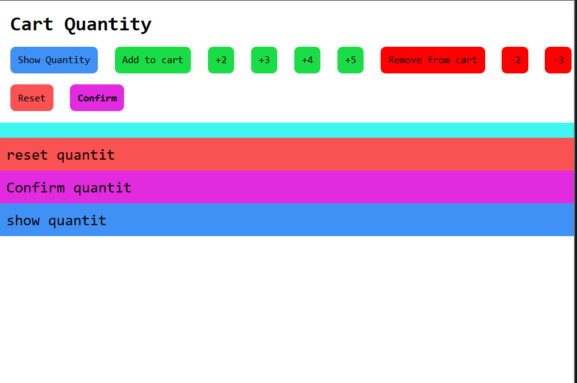
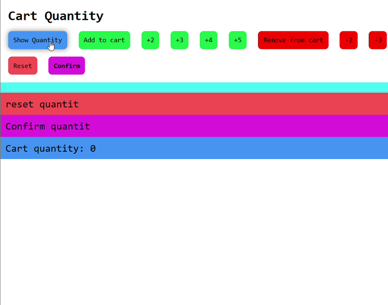
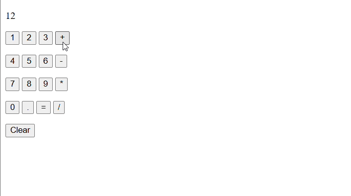
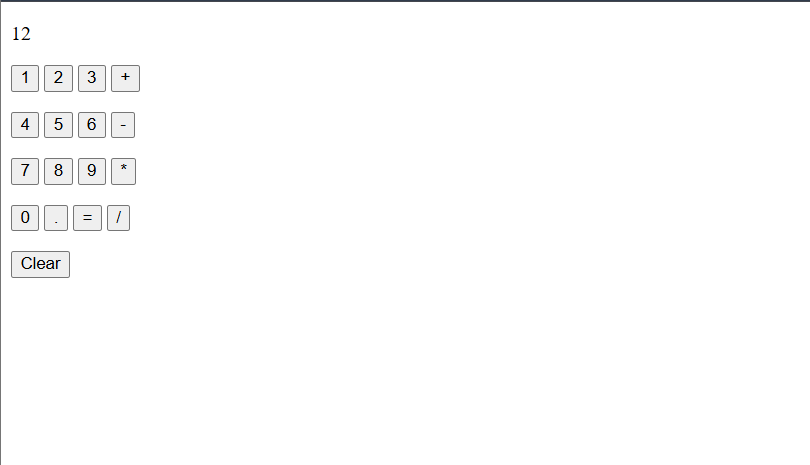

<div align="center">

# ⚡ JavaScript Learning Journey

**Small exercises. New concepts. One step closer to building interactive websites.**


My practice repository as I learn JavaScript with **SuperSimpleDev**, following my HTML and CSS studies.

[Explore the lessons](#what-i-learned) · [Try it yourself](#how-to-use) · [Meet the author](https://github.com/Elmahdi25)

</div>

---

## About this repository

This is where I practice JavaScript, experiment with examples, and document what I understand along the way. My goal is to move from writing simple instructions to building interactive websites and solving problems independently.


This repository is a learning journal that will grow as I continue the course.

## Chapter index

| Chapter | Topic | Status |
| --- | --- | --- |
| [01](#chapter-01--javascript-basics) | JavaScript Basics | Covered |
| [02](#chapter-02--numbers--math) | Numbers & Math | Covered |
| [03](#chapter-03--strings) | Strings | Covered |
| [04](#chapter-04--html-css--javascript) | HTML, CSS & JavaScript | Covered |
| [05](#chapter-05--variables) | Variables | Covered |
| [06](#chapter-06--booleans--if-statements) | Booleans & If Statements | Covered |
| [07](#chapter-07--functions) | Functions | Covered |
| [08](#chapter-08--objects--json) | Objects, JSON & localStorage | Covered |
| [09](#chapter-09--dom-document-object-model) | DOM (Document Object Model) | Covered |
| [10](#chapter-10-arrays--loops) | Arrays, loops, accumulator pattern, and dynamic HTML | Covered |

Each chapter uses a stable two-digit number. Subsections use the same prefix, such as **03.1**, so new lessons can be added without renumbering earlier chapters.

## Preview

From my first popup to calculating a shopping total:

```js
alert('Hello!');

// Calculate prices in cents, then convert to dollars.
console.log((2095 + 799) / 100); // 28.94

// Round tax to the nearest cent before converting.
console.log(Math.round((2095 + 799) * 0.1) / 100); // 2.89
```

## Tools I use

| Tool | Purpose |
| --- | --- |
| JavaScript | Instructions, calculations, and page changes |
| HTML | The page that loads my JavaScript |
| VS Code | Writing and organizing my files |
| Browser DevTools | Trying expressions and checking errors |
| Git & GitHub | Tracking changes and sharing my progress |

## Project structure

| File | Purpose |
| --- | --- |
| `index.html` | Entry page that loads the JavaScript file |
| `basics.js` | JavaScript practice and experiments |
| `3_strings/exersices.js` | String exercises (current local chapter file) |
| `README.md` | Learning notes and progress |

## How to use

1. Download the repository, or clone it using its GitHub **Code** button.
2. Open the project folder in VS Code.
3. Open `index.html` in a browser.
4. Press **F12** and select **Console** to inspect output and errors.
5. Edit the JavaScript file loaded by the page, save it, and refresh to try your changes.

No package installation is needed for these browser-based exercises.

To load the script after the HTML has been parsed, use this inside `<head>`:

```html
<script src="basics.js" defer></script>
```

## What I learned

## Chapter 01 — JavaScript Basics

### 01.1 Code, syntax, and the console

- **Code** is a set of instructions that a computer follows.
- **Running code** means executing those instructions.
- **Syntax** is the set of rules for writing valid code.
- JavaScript is **case-sensitive**: `innerHTML` and `innerHtml` are different names.
- The browser console lets me test small pieces of JavaScript immediately.

```js
alert('Hello');
alert('Good job!');
```

### 01.2 Changing a web page

```js
document.body.innerHTML = 'Hello';
```

This replaces the content inside the page's `<body>` with `Hello`. The body must exist before this instruction runs.

## Chapter 02 — Numbers & Math

### 02.1 Numbers and arithmetic

```js
2 + 2;  // 4 — addition
10 - 3; // 7 — subtraction
3 * 4;  // 12 — multiplication
10 / 2; // 5 — division
```

I learned the difference between **integers**, such as `2`, and **floating-point numbers**, such as `2.8`.

### 02.2 Order of operations

Multiplication and division happen before addition and subtraction. Parentheses let me control which calculation happens first.

```js
2 + 3 * 4;   // 14
(2 + 3) * 4; // 20
```

### 02.3 Calculating money

Some decimal numbers cannot be represented exactly by the computer:

```js
0.1 + 0.2; // 0.30000000000000004
```

For these shopping exercises, I calculate prices using integer cents and convert to dollars at the end.

```js
(2095 + 799) / 100; // 28.94
```

For a 10% tax, I round the calculated cents before converting:

```js
Math.round((2095 + 799) * 0.1) / 100; // 2.89
```

### 02.4 Rounding numbers

The course introduced `Math.round()`. I also explored rounding up, rounding down, and removing the decimal part.

| Method | Meaning | Example | Result |
| --- | --- | --- | --- |
| `Math.round()` | Round to the nearest integer | `Math.round(2.8)` | `3` |
| `Math.floor()` | Round down | `Math.floor(2.8)` | `2` |
| `Math.ceil()` | Round up | `Math.ceil(2.1)` | `3` |
| `Math.trunc()` | Remove the decimal part | `Math.trunc(2.8)` | `2` |

Negative numbers helped me understand the difference:

```js
Math.floor(-2.8); // -3
Math.ceil(-2.8);  // -2
Math.trunc(-2.8); // -2
```

### 02.5 Learning to find answers

I am practicing how to describe a problem clearly, search for the JavaScript feature I need, and test an example before using it. Understanding why the code works is part of the exercise.

## Chapter 03 — Strings

### 03.1 What is a string?

A **string** represents text. Numbers and strings are different value types.

```js
'Hello';
'123'; // A string, even though it contains digits.
123;   // A number.

typeof 'Hello'; // "string"
typeof 123;     // "number"
```

### 03.2 Concatenation

**Concatenation** means joining strings with `+`. Spaces must be included explicitly.

```js
'some' + 'text';           // "sometext"
'some' + ' ' + 'text';     // "some text"
'some' + ' more' + ' text'; // "some more text"
```

### 03.3 Strings, numbers, and type coercion

With a string operand, `+` joins text instead of adding numbers. JavaScript automatically converts the other number to a string: this is **type coercion**.

```js
'Hello ' + 3; // "Hello 3"
2 + 3;       // 5
'2' + 3;     // "23"
```

Addition and concatenation are evaluated from left to right:

```js
'$' + 5 + 3; // "$53"
5 + 3 + '$'; // "8$"
```

### 03.4 Parentheses before concatenation

Expressions involving strings follow the same order of operations. Expressions inside parentheses are evaluated first.

```js
'$' + (5 + 3); // "$8"

// Calculate in cents, then join the result to the text.
'$' + (2095 + 799) / 100; // "$28.94"

'Items (' + (1 + 1) + '): $' + (2095 + 799) / 100;
// "Items (2): $28.94"
```

### 03.5 Three ways to write strings

```js
'Hello'; // Single quotes.
"Hello"; // Double quotes.
`Hello`; // Backticks: a template literal (template string).
```

I use single quotes for simple text, double quotes when convenient for an apostrophe, and backticks for interpolation or multiline text.

```js
"I'm learning JavaScript";
```

### 03.6 Escape sequences

A backslash introduces an **escape sequence**. It lets me include special characters without ending the string.

| Sequence | Meaning |
| --- | --- |
| `\'` | Single quote |
| `\"` | Double quote |
| `\n` | New line |
| `\\` | Backslash |

```js
'I\'m learning JavaScript';
"He said: \"Hello!\"";
console.log('Hello\nJavaScript');
```

The last example prints:

```text
Hello
JavaScript
```

### 03.7 Template literals and interpolation

Backticks let me insert an expression directly into a string using `${...}`. This is **interpolation**.

```js
`Total cost: $${5 + 3}`; // "Total cost: $8"

`Items (${1 + 1}): $${(2095 + 799) / 100}`;
// "Items (2): $28.94"
```

In `$${5 + 3}`, the first `$` is ordinary text for the currency sign. The second `$` starts the `${...}` expression.

### 03.8 Multiline strings

Template literals can contain actual line breaks:

```js
console.log(`Hello
JavaScript`);
```

This prints two lines, just like `'Hello\nJavaScript'`.

### 03.9 Displaying strings: browser vs terminal

`alert()` creates a browser popup. It is not available in Node.js. `console.log()` works in both environments.

```js
// Browser popup:
alert(`Total cost: $${5 + 3}`);

// Browser console or Node.js terminal:
console.log(`Total cost: $${5 + 3}`);
```

### 03.10 Extra practice: two decimal places

I also explored `.toFixed(2)` to format prices. It rounds to two decimal places and returns a **string**.

```js
(6.786).toFixed(2); // "6.79"
(2.8).toFixed(2);   // "2.80"

`Total cost: $${((2095 + 799) / 100).toFixed(2)}`;
// "Total cost: $28.94"

Number((6.786).toFixed(2)); // 6.79 (a number)
```

Floating-point representation can affect rounding at some boundaries. For these money exercises, I keep calculations in cents and format the result for display at the end.

### 03.11 Chapter recap

- A string represents text; `typeof` identifies its type.
- `+` can add numbers or concatenate strings.
- Parentheses help calculate numbers before joining them to text.
- Single quotes, double quotes, and backticks create strings.
- Escape sequences represent quotes, line breaks, and backslashes.
- Template literals support interpolation and multiline text.
- `.toFixed(2)` returns rounded text with two decimal places.

## Problems I worked through

| Problem | What I learned |
| --- | --- |
| `Cannot set properties of null` when changing the body | Run the script after the body exists, using `defer` or placing the script before `</body>`. |
| `removeChild` reports that a node is not a child | The node must be a direct child of that parent; replacing `innerHTML` can also remove existing nodes. |
| Unexpected decimal results | Use integer cents for the price calculations in these exercises. |
| `alert is not defined` in the VS Code terminal | Node.js does not provide browser popups; use `console.log()` or run the script in a browser. |
| Getting `"$53"` instead of `"$8"` | Calculate with parentheses or interpolate the numeric expression in a template literal. |
| An apostrophe ends a string early | Use double quotes or escape the apostrophe with a backslash. |
| Choosing a rounding method | Decide whether I need the nearest integer, rounding down, rounding up, or truncation. |

## Next improvements

- [ ] Add Chapter 04 after completing the next lesson.
- [ ] Add more exercises and organize them by topic.
- [ ] Learn variables, conditions, functions, and loops.
- [ ] Practice targeting individual page elements.
- [ ] Build small interactive projects as I progress.

### Screenshots from exercises


<br>


<br>


<br>


<br>


<br>


<br>


## Chapter 04 — HTML, CSS & JavaScript

### 04.1 How the three languages work together

| Language | Role |
| --- | --- |
| HTML | Creates the page structure and elements |
| CSS | Controls their appearance and layout |
| JavaScript | Adds behavior and interactivity |

HTML connects the page to its CSS and JavaScript.

### 04.2 JavaScript inside HTML

The `<script>` element lets me write JavaScript directly inside an HTML file.

```html
<body>
  <button>Click me</button>

  <script>
    alert('Hello!');
  </script>
</body>
```

This script runs when the browser reaches it while loading the page.

Placing it just before `</body>` means the HTML elements above it already exist when the JavaScript runs.

### 04.3 Using a separate JavaScript file

I can keep the three languages in separate files:

| File | Purpose |
| --- | --- |
| `index.html` | Page structure |
| `style.css` | Styling |
| `script.js` | JavaScript behavior |

Inside the HTML `<head>`:

```html
<link rel="stylesheet" href="style.css">
<script src="script.js" defer></script>
```

`defer` tells the browser to run the external script after it has parsed the HTML—after reading it and creating its elements.

Alternatively, I can load the script just before `</body>`:

```html
<script src="script.js"></script>
```

### 04.4 Running code when a button is clicked

The `onclick` attribute runs JavaScript when the user clicks an element.

```html
<button onclick="alert('Good job!');">
  Click me
</button>
```

The outer double quotes contain the JavaScript code. The inner single quotes contain the message.

| Location | When the code runs |
| --- | --- |
| A regular `<script>` element | When the browser reaches the script |
| An external script with `defer` | After the HTML has been parsed |
| An `onclick` handler | Each time the element is clicked |

### 04.5 Keeping the click behavior in script.js

I also practiced attaching the click behavior from a separate JavaScript file.

**HTML:**

```html
<button id="hello-button">Click me</button>
```

**JavaScript:**

```js
document.querySelector('#hello-button').onclick = function () {
  alert('Good job!');
};
```

- `querySelector('#hello-button')` finds the element with that ID.
- `.onclick` assigns its click handler.
- The function body runs when the button is clicked.

The button must exist before this code runs, so I use `defer` or load the script at the bottom of the body.

### 04.6 Comments

Comments explain code to people. They are not executed.

**JavaScript:**

```js
// A single-line comment.

/*
  A comment that
  spans several lines.
*/
```

**HTML:**

```html
<!-- An HTML comment. -->
```

**CSS:**

```css
/* A CSS comment. */
```

I can also temporarily disable a line by commenting it out:

```js
// alert('Hello!');
```

Comments remain part of the source file and appear on GitHub when committed and pushed.

### 04.7 Displaying results with console.log()

An expression inside a script is evaluated, but its result is not automatically displayed.

```js
2 + 2; // Calculated, but no visible output.
```

To inspect the result, I use `console.log()`:

```js
console.log(2 + 2);              // 4
console.log('some' + ' text');   // "some text"
console.log(`Total: $${5 + 3}`); // "Total: $8"
```

I open the browser’s DevTools with **F12**, then select **Console** to see the output.

`console.log()` writes to the console; it does not add text to the web page.

### 04.8 Chapter recap

- HTML creates structure, CSS adds styling, and JavaScript adds behavior.
- `<script>` runs JavaScript inside HTML.
- `src` loads JavaScript from a separate file.
- `defer` lets the HTML be parsed before an external script runs.
- `onclick` runs code when an element is clicked.
- Comments explain or temporarily disable code.
- `console.log()` helps inspect results and debug code.


<br>


## Chapter 05 — Variables

### 05.1 Saving and using values

A **variable** is a named place to store a value so I can use it later.

```js
let cartQuantity = 0;
console.log(cartQuantity); // 0
```

- `let` declares the variable.
- `cartQuantity` is its name.
- `=` assigns a value.
- `0` is the initial value.

Without quotes, JavaScript reads the variable's value. With quotes, it reads ordinary text:

```js
console.log(cartQuantity);   // 0
console.log('cartQuantity'); // "cartQuantity"
```

### 05.2 Storing calculation results

A variable can store a number, a string, or the result of an expression.

```js
const calculation = 2 + 2;
const result = calculation + 2;
const message = 'Hello';

console.log(calculation); // 4
console.log(result);      // 6
console.log(message);     // "Hello"
```

The expression on the right is evaluated first, then its result is stored.

A calculation is not automatically repeated when another variable changes:

```js
let price = 5;
const total = price + 3; // Stores 8.

price = 10;
console.log(total); // Still 8.
```

### 05.3 Reassigning a variable

**Reassignment** replaces a variable's current value.

```js
let quantity = 3;
console.log(quantity); // 3

quantity = 5;
console.log(quantity); // 5
```

I declare the variable with `let` once. To update it, I use its name without repeating `let`.

`=` means **assign**, not “check whether two values are equal.”

### 05.4 Updating a value using itself

```js
let cartQuantity = 0;

cartQuantity = cartQuantity + 1;
console.log(cartQuantity); // 1
```

JavaScript:

1. Reads the current value: `0`.
2. Adds `1`.
3. Stores the result back in `cartQuantity`.

Simply calculating `cartQuantity + 1` does not update the variable. The result must be assigned back.

### 05.5 Assignment shortcuts

For a numeric variable, these shortcuts make updates shorter:

| Shortcut | Equivalent |
| --- | --- |
| `quantity += 2;` | `quantity = quantity + 2;` |
| `quantity -= 2;` | `quantity = quantity - 2;` |
| `quantity *= 2;` | `quantity = quantity * 2;` |
| `quantity /= 2;` | `quantity = quantity / 2;` |
| `quantity++;` | Increase by 1 |
| `quantity--;` | Decrease by 1 |

For example:

```js
let quantity = 0;

quantity++;    // 1
quantity += 2; // 3
quantity--;    // 2
quantity = 0; // Reset to 0.
```

### 05.6 Choosing const, let, or var

| Keyword | Can be reassigned? | When I use it |
| --- | --- | --- |
| `const` | No | Default choice when reassignment is unnecessary |
| `let` | Yes | When the value needs to change |
| `var` | Yes | Older code; prefer `const` or `let` in new code |

```js
const message = 'Welcome!';
let cartQuantity = 0;

cartQuantity += 1; // Works.
// message = 'Hello'; // Would cause an error.
```

A `const` declaration needs an initial value.

`const` prevents **reassignment**. Later, when working with objects and arrays, their contents can still change.

### 05.7 Naming variables clearly

I use **camelCase**: the first word starts lowercase, and each following word starts uppercase.

```js
let cartQuantity = 0;
const totalPrice = 28.94;
const welcomeMessage = 'Hello!';
```

Essential naming rules:

- Names cannot start with a digit.
- Names cannot contain spaces or hyphens.
- Reserved keywords such as `let` cannot be used as names.
- Letters, digits after the first character, `_`, and `$` are allowed.
- Names are case-sensitive: `cartQuantity` and `cartquantity` are different.

| Style | Example | Typical use |
| --- | --- | --- |
| camelCase | `cartQuantity` | JavaScript variables |
| PascalCase | `CartQuantity` | JavaScript classes, covered later |
| kebab-case | `cart-quantity` | File names and CSS classes; invalid as a variable name |
| snake_case | `cart_quantity` | Valid in JavaScript, but not my default style |

I choose names that explain their purpose without becoming unnecessarily long.

### 05.8 Variables inside strings and typeof

Template literals let me display a variable's current value:

```js
let cartQuantity = 3;

console.log(`Cart quantity: ${cartQuantity}`);
// "Cart quantity: 3"
```

`typeof` identifies the type of the value currently stored:

```js
const quantity = 3;
const message = 'Hello';

console.log(typeof quantity); // "number"
console.log(typeof message);  // "string"
```

### 05.9 Mini project: cart quantity

This example connects variables to button clicks. Results appear in the browser console.

```html
<button onclick="console.log(`Cart quantity: ${cartQuantity}`);">
  Show quantity
</button>

<button onclick="
  cartQuantity++;
  console.log(`Cart quantity: ${cartQuantity}`);
">
  Add to cart
</button>

<button onclick="
  cartQuantity += 2;
  console.log(`Cart quantity: ${cartQuantity}`);
">
  +2
</button>

<button onclick="
  cartQuantity += 3;
  console.log(`Cart quantity: ${cartQuantity}`);
">
  +3
</button>

<button onclick="
  cartQuantity = 0;
  console.log('Cart was reset.');
  console.log(`Cart quantity: ${cartQuantity}`);
">
  Reset cart
</button>

<script>
  let cartQuantity = 0;
</script>
```

The variable stores the current quantity between clicks. Each button reads or updates that same variable.

Refreshing the page runs the script again and resets the quantity to `0`. Saving values between page visits is a separate topic.

### 05.10 Semicolons

A semicolon ends a JavaScript statement:

```js
const message = 'Hello';
console.log(message);
```

JavaScript can automatically insert semicolons in some situations. I use them consistently in these exercises to make statement boundaries clear.

### 05.11 Chapter recap

- Variables store values for later use.
- Expressions are evaluated before their results are assigned.
- Reassignment updates an existing variable without declaring it again.
- `+=`, `-=`, `*=`, `/=`, `++`, and `--` simplify updates.
- I use `const` by default and `let` when reassignment is needed.
- Clear camelCase names make code easier to understand.
- Template literals display variable values; `typeof` checks their types.
- Variables let interactive features remember their current state between actions.


## Chapter 06 — Booleans & If Statements

### 06.1 Boolean values

A **boolean** represents whether something is true or false. It has only two possible values: `true` and `false`.

```js
console.log(3 < 5); // true
console.log(3 > 5); // false

console.log(typeof true);   // "boolean"
console.log(typeof 'true'); // "string"
```

Booleans do not use quotes. `'false'` is text, not the boolean `false`.

### 06.2 Comparison operators

Comparisons produce a boolean result.

| Operator | Meaning | Example | Result |
| --- | --- | --- | --- |
| `>` | Greater than | `5 > 3` | `true` |
| `<` | Less than | `5 < 3` | `false` |
| `>=` | Greater than or equal to | `5 >= 5` | `true` |
| `<=` | Less than or equal to | `3 <= 5` | `true` |
| `===` | Strict equality | `5 === '5'` | `false` |
| `!==` | Strict inequality | `5 !== '5'` | `true` |

I use `===` and `!==` by default because they do not automatically convert different value types.

```js
5 == '5';  // true — type conversion.
5 === '5'; // false — different types.
```

`=` assigns a value; `===` compares values.

Arithmetic is evaluated before comparisons:

```js
3 > 5 - 5; // true, because 3 > 0.
```

### 06.3 Making decisions with if, else if, and else

An `if` statement runs a block of code when its condition is truthy.

```js
const cartQuantity = 3;

if (cartQuantity > 0) {
  console.log('The cart has products.');
} else {
  console.log('The cart is empty.');
}
```

`else if` adds another condition:

```js
const score = 75;

if (score >= 80) {
  console.log('Excellent!');
} else if (score >= 50) {
  console.log('Passed.');
} else {
  console.log('Try again.');
}
```

Conditions are checked from top to bottom. **Only the first matching branch runs.** If none match, the optional `else` branch runs.

I keep curly braces `{}` around each branch to make the code clear.

### 06.4 Logical operators

Logical operators combine or reverse conditions.

| Operator | Meaning with boolean conditions |
| --- | --- |
| `&&` | AND: both conditions must be true |
| `\|\|` | OR: at least one condition must be true |
| `!` | NOT: reverses true and false |

```js
const quantity = 5;

console.log(quantity > 0 && quantity <= 10); // true
console.log(quantity === 0 || quantity === 5); // true
console.log(!(quantity > 0)); // false
```

To check a range, I compare both boundaries explicitly:

```js
quantity > 0 && quantity <= 10;
```

I do not write `0 < quantity <= 10`, because JavaScript does not interpret it as a mathematical range.

### 06.5 Random numbers and algorithms

`Math.random()` produces a number greater than or equal to `0` and less than `1`.

I can divide that range into three parts to choose a computer move:

```js
const randomNumber = Math.random();
let computerMove = '';

if (randomNumber < 1 / 3) {
  computerMove = 'rock';
} else if (randomNumber < 2 / 3) {
  computerMove = 'paper';
} else {
  computerMove = 'scissors';
}

console.log(computerMove);
```

The second branch is reached only when the first condition is false, so it already excludes numbers below `1 / 3`.

An **algorithm** is a sequence of steps for solving a problem. For Rock Paper Scissors:

1. Read the player's move.
2. Generate the computer's move.
3. Compare the moves.
4. Display the result.

Example for a player who chooses rock:

```js
let result = '';

if (computerMove === 'rock') {
  result = 'Tie.';
} else if (computerMove === 'paper') {
  result = 'You lose.';
} else {
  result = 'You win.';
}

console.log(`You picked rock. Computer picked ${computerMove}. ${result}`);
```

### 06.6 Truthy and falsy values

Conditions can use values other than booleans.

- **Truthy** values behave like `true` in a condition.
- **Falsy** values behave like `false` in a condition.

Common falsy values are:

| Value | Meaning |
| --- | --- |
| `false` | Boolean false |
| `0` | Zero |
| `''` | Empty string |
| `NaN` | An invalid numeric result |
| `undefined` | Often a value that has not been assigned |
| `null` | Intentional absence of a value |

`-0` and the BigInt value `0n` are also falsy.

```js
if (5) {
  console.log('Runs.');
}

if (0) {
  console.log('Does not run.');
}
```

Nonempty strings and negative numbers are truthy:

```js
console.log(Boolean('false')); // true
console.log(Boolean('0'));     // true
console.log(Boolean(-1));      // true
```

For quantities, `cartQuantity > 0` expresses the intention more clearly than simply checking `cartQuantity`, especially if negative values are possible.

### 06.7 NaN and undefined

`NaN` means “Not a Number.” It can result from an invalid numeric calculation.

```js
console.log('Hello' / 5); // NaN
```

A variable declared with `let` without an initial value contains `undefined`:

```js
let message;
console.log(message); // undefined
```

A `const` declaration must have an initial value.

### 06.8 Ternary operator

The **ternary operator** selects one of two values:

```js
condition ? valueIfTruthy : valueIfFalsy;
```

It is useful for assigning a simple conditional result:

```js
const quantity = 3;
const message = quantity > 0 ? 'Cart has products.' : 'Cart is empty.';

console.log(message); // "Cart has products."
```

For several actions or complicated conditions, an `if` statement is easier to read.

### 06.9 Short-circuit evaluation

`&&` and `||` can stop before evaluating their right-hand side.

**AND (`&&`):** if the left value is falsy, it returns that value immediately. Otherwise, it evaluates and returns the right value.

```js
false && console.log('Hello'); // Does not print.
true && console.log('Hello');  // Prints "Hello".

console.log(0 && 'Hello'); // 0
console.log(5 && 'Hello'); // "Hello"
```

This can act as a **guard** that allows code to run only when a condition is truthy.

**OR (`||`):** if the left value is truthy, it returns that value immediately. Otherwise, it evaluates and returns the right value.

```js
const selectedCurrency = '';
const currency = selectedCurrency || 'USD';

console.log(currency); // "USD"
console.log('EUR' || 'USD'); // "EUR"
```

This can provide a **default value**. However, it replaces every falsy value, including `0`, `false`, and `''`.

`&&` and `||` return operand values—not necessarily booleans.

### 06.10 Chapter recap

- Booleans are `true` or `false`, without quotes.
- Comparisons produce boolean results.
- `===` and `!==` avoid automatic type conversion.
- `if`, `else if`, and `else` select which branch runs.
- `&&`, `||`, and `!` combine or reverse conditions.
- `Math.random()` helps generate random choices.
- Algorithms turn a problem into clear steps.
- Truthy and falsy values determine how conditions behave.
- Ternary expressions choose values; short-circuit operators can guard code or provide defaults.


## Chapter 07 — Functions

### 07.1 Creating and calling a function

A **function** groups code that I can reuse instead of repeating it.

```js
function showMessage() {
  console.log('Hello!');
  console.log(2 + 2);
}

showMessage();
showMessage();
```

- `function` declares the function.
- `showMessage` is its name.
- `{ ... }` contains its body.
- `showMessage()` calls it and runs the code inside.

**Declaring a function does not run its body.** Each call runs it again.

I use clear camelCase names that describe an action, such as `calculateTax` or `pickComputerMove`.

### 07.2 Parameters and arguments: inputs

**Parameters** are names declared in a function's parentheses. **Arguments** are the actual values supplied when calling it.

```js
function greet(name) {
  console.log(`Hello, ${name}!`);
}

greet('Mehdi'); // "Hello, Mehdi!"
greet('Sara');  // "Hello, Sara!"
```

Here, `name` is the parameter, and `'Mehdi'` is an argument.

Parameters let the same function work with different inputs.

A function can take multiple parameters, separated by commas. Arguments match them by position:

```js
function showTotal(price, quantity) {
  console.log(price * quantity);
}

showTotal(5, 3); // 15
```

### 07.3 Return values: outputs

`return` sends a value back to the code that called the function.

```js
function add(firstNumber, secondNumber) {
  return firstNumber + secondNumber;
}

const total = add(5, 3);
console.log(total); // 8
```

I can store the returned value, display it, or use it in another calculation.

**`console.log()` displays a value; `return` makes a value available to the caller.** They are different operations.

```js
function displaySum(a, b) {
  console.log(a + b);
}

const result = displaySum(5, 3);
// Prints 8, but result contains undefined.
```

A function returns `undefined` if it finishes without returning a value.

### 07.4 Return ends the current function call

Once JavaScript reaches `return`, it exits that function call immediately.

```js
function checkQuantity(quantity) {
  if (quantity > 10) {
    return 'Cart is full.';
  }

  return 'Quantity accepted.';
}

console.log(checkQuantity(11)); // "Cart is full."
console.log(checkQuantity(5));  // "Quantity accepted."
```

Code after a return is not executed on that path.

### 07.5 Scope: where variables are accessible

Parameters and variables declared inside a function are local to it.

```js
function createMessage() {
  const message = 'Hello!';
  return message;
}

const greeting = createMessage();
console.log(greeting); // "Hello!"

// console.log(message); // ReferenceError: message is not defined.
```

Returning `message` gives the caller its **value**. It does not make the local variable accessible outside the function.

Variables declared with `let` or `const` inside an `if` block are also limited to that block.

I prefer local variables and return values over unnecessary global variables. This reduces naming conflicts and makes functions easier to understand.

### 07.6 Default parameters

A default parameter provides a value when an argument is omitted or explicitly passed as `undefined`.

```js
function calculateTax(costInCents, taxRate = 0.1) {
  return Math.round(costInCents * taxRate);
}

console.log(calculateTax(2000, 0.2)); // 400 cents
console.log(calculateTax(5000));      // 500 cents
```

- The first call supplies a 20% rate.
- The second uses the default 10% rate.

Without a default, a missing argument gives the parameter the value `undefined`. Using it in multiplication can produce `NaN`.

A supplied value of `0` is kept; it does not trigger the default.

### 07.7 Reusing code in Rock Paper Scissors

Instead of copying the computer-move logic into every button, I put it in one function:

```js
function pickComputerMove() {
  const randomNumber = Math.random();

  if (randomNumber < 1 / 3) {
    return 'rock';
  } else if (randomNumber < 2 / 3) {
    return 'paper';
  } else {
    return 'scissors';
  }
}

const computerMove = pickComputerMove();
console.log(computerMove);
```

The game can use a second function, `playGame(playerMove)`, to handle different player choices:

```html
<button onclick="playGame('rock');">Rock</button>
<button onclick="playGame('paper');">Paper</button>
<button onclick="playGame('scissors');">Scissors</button>
```

Inside `playGame`, I can call `pickComputerMove()`, compare the moves, and display the result.

**Functions can call other functions.** This lets me split a larger task into smaller, reusable steps.

Removing duplication means I only need to update shared logic in one place.

### 07.8 Tracing a function call

To understand the execution order, I follow the code step by step:

1. The caller supplies arguments.
2. The function receives them through its parameters.
3. Its body runs from top to bottom.
4. `return` sends a result back and ends the call.
5. The caller continues using that result.

### 07.9 Chapter recap

- Functions group reusable code and reduce duplication.
- Declaring a function and calling it are separate actions.
- Parameters receive inputs; arguments supply them.
- `return` provides an output and ends the current call.
- Logging a result does not return it.
- Local variables and parameters stay inside their scope.
- Default parameters handle omitted or undefined arguments.
- Functions can call other functions to organize larger tasks.

## Chapter 08 — Objects & JSON

### 08.1 Grouping related values

An **object** groups related values into properties.

```js
const product = {
  name: 'Socks',
  price: 1090
};
```

Each property has a **key** and a **value**, separated by a colon. Properties are separated by commas.

Objects help organize related data instead of keeping everything in separate variables.

### 08.2 Reading, updating, adding, and deleting properties

**Dot notation** accesses a property by name:

```js
console.log(product.name);  // "Socks"
console.log(product.price); // 1090
```

I can also modify the object:

```js
product.name = 'Cotton socks'; // Update.
product.inStock = true;       // Add.

delete product.inStock;       // Delete.

console.log(product.inStock); // undefined.
```

Reading a property that does not exist returns `undefined`.

**An object declared with `const` can still have its properties changed.** `const` prevents reassigning the variable to a different value.

```js
product.price = 1200; // Allowed.
// product = {};     // Not allowed.
```

### 08.3 Bracket notation

Bracket notation provides another way to access properties:

```js
console.log(product['name']); // "Cotton socks"
```

It is useful when a property contains characters that do not work with dot notation, or when its name comes from a variable.

```js
const delivery = {
  'delivery-time': '1 day'
};

console.log(delivery['delivery-time']); // "1 day"

const propertyName = 'price';
console.log(product[propertyName]); // 1200.
```

`product[propertyName]` uses the value stored in the variable. `product.propertyName` looks for a property literally named `propertyName`.

I use dot notation for simple, fixed property names and brackets when needed.

### 08.4 Nested objects

An object can contain another object.

```js
const shirt = {
  name: 'Shirt',
  rating: {
    stars: 4.5,
    count: 87
  }
};

console.log(shirt.rating.stars); // 4.5
console.log(shirt.rating.count); // 87
```

Nested objects help group related details within a larger object.

### 08.5 Methods: functions inside objects

A function stored as an object's property is called a **method**.

```js
const person = {
  name: 'Mehdi',

  sayHello: function () {
    console.log('Hello!');
  }
};

person.sayHello();
```

- `person` is the object.
- `sayHello` is its method.
- `person.sayHello()` calls that method.

Methods I have already used include:

| Object | Method | Purpose |
| --- | --- | --- |
| `console` | `log()` | Display information |
| `Math` | `random()` | Generate a random number |
| `JSON` | `stringify()` | Convert a supported value to JSON text |
| `JSON` | `parse()` | Convert JSON text to a JavaScript value |

`Math` and `JSON` are built into JavaScript. `console` is provided by the runtime, such as a browser or Node.js.

### 08.6 Using an object to track a score

Related counters can be stored in one object:

```js
const score = {
  wins: 0,
  losses: 0,
  ties: 0
};
```

After determining a round's result:

```js
if (result === 'You Win') {
  score.wins++;
} else if (result === 'You Lose') {
  score.losses++;
} else if (result === 'Tie') {
  score.ties++;
}
```

I create the score outside the function that runs each round so it is not reset on every call.

Displaying and resetting the score have separate responsibilities:

```js
function showScore() {
  console.log(
    `Wins: ${score.wins}, Losses: ${score.losses}, Ties: ${score.ties}`
  );
}

function resetScore() {
  score.wins = 0;
  score.losses = 0;
  score.ties = 0;

  showScore();
}
```

Showing or resetting the score should not play a round or increase a counter.

The object keeps its values between rounds while the page stays open. Keeping them after a refresh requires storage, which is a separate topic.

### 08.7 What is JSON?

**JSON** stands for **JavaScript Object Notation**. It is a text format used to exchange and store data.

Its syntax resembles JavaScript object syntax, but the rules are stricter.

| JavaScript object syntax | JSON syntax |
| --- | --- |
| Property names can often be unquoted | Property names must use double quotes |
| Strings can use single or double quotes | Strings must use double quotes |
| Properties can contain functions | Functions are not supported |
| Trailing commas are allowed | Trailing commas are not allowed |

Example JSON:

```json
{
  "name": "Socks",
  "price": 1090,
  "inStock": true
}
```

JSON is understood by many programming languages, making it useful for sharing data between different systems.

### 08.8 JSON.stringify(): from a value to JSON text

`JSON.stringify()` converts a supported JavaScript value into a JSON string.

```js
const product = {
  name: 'Socks',
  price: 1090
};

const jsonString = JSON.stringify(product);

console.log(jsonString);
// '{"name":"Socks","price":1090}'

console.log(typeof jsonString); // "string"
```

The result is **text**, not an object with directly accessible product properties.

Function-valued properties are omitted when an object is converted:

```js
const example = {
  message: 'Hello',
  greet: function () {
    console.log('Hello');
  }
};

console.log(JSON.stringify(example));
// '{"message":"Hello"}'
```

### 08.9 JSON.parse(): from JSON text to a value

`JSON.parse()` reads valid JSON text and produces the corresponding JavaScript value.

```js
const jsonString = '{"name":"Socks","price":1090}';
const restoredProduct = JSON.parse(jsonString);

console.log(restoredProduct.name);  // "Socks"
console.log(restoredProduct.price); // 1090
```

| Method | Input | Output |
| --- | --- | --- |
| `JSON.stringify()` | A supported JavaScript value | JSON string |
| `JSON.parse()` | Valid JSON string | JavaScript value |

`JSON.parse()` throws an error if the text is not valid JSON. Functions omitted during stringification are not restored.

### 08.10 Chapter recap

- Objects group related values into properties.
- Dot and bracket notation access those properties.
- Properties can be updated, added, or deleted.
- `const` allows property changes while preventing variable reassignment.
- Nested objects organize related groups of data.
- A function stored in an object is called a method.
- A score object keeps related counters together.
- JSON is a text format for exchanging and storing data.
- `JSON.stringify()` creates JSON text; `JSON.parse()` reads it.

### 08.11 Saving data with localStorage

Variables hold the running page's data. Refreshing the page starts the script again and recreates those variables.

`localStorage` keeps saved data across refreshes and browser sessions, unless it is cleared. Its data belongs to the website's origin.

| Method | Purpose |
| --- | --- |
| `setItem(key, value)` | Save or replace an entry |
| `getItem(key)` | Read an entry |
| `removeItem(key)` | Delete an entry |

```js
localStorage.setItem('message', 'Hello');

console.log(localStorage.getItem('message')); // "Hello"

localStorage.removeItem('message');

console.log(localStorage.getItem('message')); // null
```

The key identifies the entry. Saving under the same key replaces its previous value.

### 08.12 Saving and restoring objects

localStorage stores strings. To save an object, I convert it to JSON text:

```js
localStorage.setItem('score', JSON.stringify(score));
```

To restore it, I read the saved text and parse it:

```js
let score = JSON.parse(localStorage.getItem('score'));

if (score === null) {
  score = {
    wins: 0,
    losses: 0,
    ties: 0
  };
}
```

The sequence is:

1. `getItem()` reads the saved string.
2. `JSON.parse()` converts it into a JavaScript object.
3. If the entry is missing, `getItem()` returns `null`.
4. `JSON.parse(null)` returns `null`, so the condition creates a zero score.

A shorter version uses a default value:

```js
let score = JSON.parse(localStorage.getItem('score')) || {
  wins: 0,
  losses: 0,
  ties: 0
};
```

Here, `||` supplies the default object when the parsed result is falsy. This example assumes any saved score contains valid JSON in the expected format.

### 08.13 The current score and saved score are separate

Changing the JavaScript object does not automatically update localStorage.

```js
score.wins++;

// Explicitly save the updated score.
localStorage.setItem('score', JSON.stringify(score));
```

Likewise, deleting the saved entry does not change the current object.

| Action | Current score object | Saved entry |
| --- | --- | --- |
| `score.wins++` | Changes | Unchanged |
| `setItem(...)` | Unchanged | Saved or replaced |
| `removeItem('score')` | Unchanged | Deleted |
| Refresh | Recreated by initialization | Remains unless previously deleted |

### 08.14 Resetting correctly

Reset must update the running game and handle its saved data:

```js
function resetScore() {
  score.wins = 0;
  score.losses = 0;
  score.ties = 0;

  localStorage.removeItem('score');
}
```

- The property assignments reset the current game.
- `removeItem()` deletes the saved entry.
- It does not restart the script or rerun the initialization condition.
- On the next refresh, missing storage causes initialization to create a zero score.

If I play before refreshing, the next round updates the zero score and saves it again.

Alternatively, I can save the zero score instead of removing the entry:

```js
localStorage.setItem('score', JSON.stringify(score));
```

Both approaches work with the initialization above.

### 08.15 null and undefined

| Value | Typical meaning |
| --- | --- |
| `undefined` | A value has not been supplied or assigned |
| `null` | An explicit empty value; also returned by some APIs for missing results |

Both are falsy, but they are different values:

```js
console.log(null === undefined); // false
```

Default parameters apply to `undefined`, not `null`:

```js
function greet(name = 'Guest') {
  return name;
}

console.log(greet(undefined)); // "Guest"
console.log(greet(null));      // null
```

### 08.16 Properties and methods on primitive values

Strings are primitive values, but JavaScript lets me access properties and methods through automatic wrapping, often called **autoboxing**.

```js
console.log('hello'.length);        // 5
console.log('hello'.toUpperCase()); // "HELLO"
```

The uppercase method returns a new string; it does not modify the original:

```js
const message = 'hello';
const uppercaseMessage = message.toUpperCase();

console.log(message);          // "hello"
console.log(uppercaseMessage); // "HELLO"
```

Numbers and booleans also support wrapper-based property access. `null` and `undefined` do not.

### 08.17 Object references

Assigning an object to another variable does not create an independent copy. Both variables refer to the same object.

```js
const firstScore = { wins: 0 };
const secondScore = firstScore;

secondScore.wins = 5;

console.log(firstScore.wins); // 5
```

I imagine both variables holding the same ticket to one object in memory.

`const` prevents reassigning the variable, but allows changes to the referenced object:

```js
firstScore.wins = 10; // Allowed.
// firstScore = {};  // Not allowed.
```

### 08.18 Comparing objects

`===` compares object identity, not property contents.

```js
const first = { wins: 0 };
const second = { wins: 0 };
const third = first;

console.log(first === second); // false: separate objects.
console.log(first === third);  // true: same object.
```

To compare a particular value, I access that property:

```js
console.log(first.wins === second.wins); // true
```

Matching one property does not prove that every property matches.

### 08.19 Destructuring

Destructuring reads properties into variables with matching names:

```js
const product = {
  name: 'Shirt',
  price: 799
};

const { name, price } = product;

console.log(name);  // "Shirt"
console.log(price); // 799
```

This is a shorter way to write:

```js
const name = product.name;
const price = product.price;
```

It does not remove those properties from the object or create a live connection to them.

### 08.20 Shorthand properties and methods

When a property name matches a variable name, I can write it once:

```js
const message = 'Good job!';

const notification = {
  message
};
```

`{ message }` means `{ message: message }`.

Methods also have a shorter syntax:

```js
const notification = {
  message,

  showMessage() {
    console.log('Good job!');
  }
};

notification.showMessage();
```

### 08.21 Completed chapter recap

- Objects group related data and methods.
- JSON converts supported data to and from text.
- localStorage keeps strings across page loads.
- The current object and saved text must be updated separately.
- Resetting properties changes the running game; removing storage changes what can be restored.
- Object assignment shares a reference rather than creating an independent copy.
- Object equality checks identity, not matching contents.
- Destructuring and shorthand syntax make object code more concise.

## Chapter 09 — DOM (Document Object Model)

### 09.1 What is the DOM?

The **DOM (Document Object Model)** represents an HTML page as objects that JavaScript can access and modify.

The browser creates a DOM representation of the HTML document. JavaScript can use the `document` object to find elements, read their content, and change the page.

```js
document.body.innerHTML = 'Hello';
```

This replaces everything inside the `<body>` with the text `Hello`.

The DOM connects JavaScript to the web page, allowing me to create interactive websites.

### 09.2 Accessing properties of the document object

The `document` object has properties that let me access different parts of the page.

```js
// Get the current page title.
console.log(document.title);

// Change the title displayed in the browser tab.
document.title = 'Good job!';

// Access the body element.
console.log(document.body);
```

- `document` represents the current HTML document.
- `document.title` gets or changes the page title.
- `document.body` gives me access to the body element.
- Dot notation lets me access an object's properties.

### 09.3 Understanding innerHTML

The `innerHTML` property lets me read or replace the HTML content inside an element.

```js
// Get the HTML inside the body.
console.log(document.body.innerHTML);

// Replace everything inside the body.
document.body.innerHTML = 'Hello';
```

I can also insert HTML elements as a string:

```js
document.body.innerHTML = '<button>Good job</button>';
```

This replaces the existing body content with a new button.

**Important:** Assigning to `document.body.innerHTML` replaces all existing content inside the body. Assigning to an individual element's `innerHTML` changes only that element's content.

For plain text, `textContent` is generally preferable because it does not interpret the assigned value as HTML.

### 09.4 Selecting HTML elements with querySelector()

The `document.querySelector()` method finds the first HTML element that matches a CSS selector.

```html
<button>Hello</button>
<button class="js-button">Second button</button>
```

```js
// Select the first button.
console.log(document.querySelector('button'));

// Select the button with a specific class.
console.log(document.querySelector('.js-button'));
```

Common selectors:

| Selector | Meaning |
| --- | --- |
| `'button'` | Select the first button element |
| `'.js-button'` | Select the first element with the class `js-button` |
| `'#my-button'` | Select the element with the ID `my-button` |

The dot (`.`) selects a class, while the hash (`#`) selects an ID.

If no matching element exists, `querySelector()` returns `null`.

### 09.5 Saving an HTML element in a variable

HTML elements can be accessed in JavaScript and stored in variables.

```js
const buttonElement = document.querySelector('.js-button');

console.log(buttonElement);
```

I can then use the variable to access the element's properties.

```js
console.log(buttonElement.innerHTML);

buttonElement.innerHTML = 'Changed';
```

This changes the text inside the selected button.

**Important distinction:**

```js
// Stores the text inside the button.
let buttonText = document.querySelector('.js-button').innerHTML;

// Stores the button element itself.
const buttonElement = document.querySelector('.js-button');
```

Changing `buttonText` only changes the variable. Changing `buttonElement.innerHTML` changes the actual content displayed on the page.

### 09.6 Making a YouTube subscribe button interactive

The DOM allows JavaScript to respond to user actions and update HTML elements.

**HTML:**

```html
<p>YouTube Subscribe Button</p>

<button class="js-subscribe-button" onclick="changeSubscribeButton()">
  Subscribe
</button>
```

**JavaScript:**

```js
function changeSubscribeButton() {
  const buttonElement = document.querySelector('.js-subscribe-button');

  if (buttonElement.innerHTML === 'Subscribe') {
    buttonElement.innerHTML = 'Subscribed';
  } else {
    buttonElement.innerHTML = 'Subscribe';
  }
}
```

When the button is clicked:

1. JavaScript selects the button using `querySelector()`.
2. It reads the current text using `innerHTML`.
3. An `if...else` statement checks the text.
4. The button changes from `Subscribe` to `Subscribed`, or back again.

This combines the DOM, functions, variables, conditions, and click events.

### 09.7 Reading input values

Input elements allow users to enter information. The `.value` property lets JavaScript read what the user entered.

```html
<input class="cost-input" placeholder="Cost of order">
<button onclick="calculate()">Calculate</button>

<p class="cost-result"></p>
```

```js
function calculate() {
  const costInput = Number(
    document.querySelector('.cost-input').value
  );

  const costResult = document.querySelector('.cost-result');

  costResult.textContent = costInput;
}
```

- `querySelector()` selects the input element.
- `.value` reads the input's current value as a string.
- `Number()` converts the string to a number.
- `textContent` displays the result inside the paragraph.

### 09.8 Mini project: Amazon shipping calculator

The goal is to calculate the total order cost, including shipping when necessary.

**Rules:**

- Orders below $40 have a $10 shipping fee.
- Orders of $40 or more have free shipping.

```html
<p>Amazon Shipping Calculator</p>
<p>Orders under $40 = $10 shipping</p>
<p>Orders $40 or more = FREE shipping</p>

<input
  type="number"
  class="cost-input"
  placeholder="Cost of order"
>

<button onclick="calculate()">Calculate</button>

<p class="cost-result"></p>
```

```js
function calculate() {
  const costInput = Number(
    document.querySelector('.cost-input').value
  );

  const costResult = document.querySelector('.cost-result');

  let totalCost = costInput;

  if (totalCost < 40) {
    totalCost += 10;
  }

  costResult.textContent = `$${totalCost}`;
}
```

**Algorithm:**

1. Read the order cost from the input.
2. Convert the input value to a number.
3. Check whether the order costs less than $40.
4. Add $10 if shipping is required.
5. Display the final total on the page.

Example results:

| Order cost | Shipping | Total |
| ---: | ---: | ---: |
| $25 | $10 | $35 |
| $39 | $10 | $49 |
| $40 | $0 | $40 |
| $60 | $0 | $60 |

### 09.9 Handling keyboard events

JavaScript can respond to keyboard actions as well as mouse clicks.

The `keydown` event occurs when a key is pressed. In HTML, `onkeydown` is an event-handler attribute that specifies what code should run when this event occurs.

```html
<input
  class="cost-input"
  onkeydown="handleCostKeydown(event)"
  placeholder="Cost of order"
>
```

```js
function handleCostKeydown(event) {
  if (event.key === 'Enter') {
    calculate();
  }
}
```

- `onkeydown` connects the keyboard event to the handler.
- `event` contains information about the keyboard action.
- `event.key` identifies the pressed key.
- When the key is `Enter`, the function calls `calculate()`.

**Workflow:**

1. The user types an order cost.
2. The user presses Enter.
3. The input's `keydown` event occurs.
4. `handleCostKeydown(event)` checks the pressed key.
5. If the key is Enter, `calculate()` runs.
6. The result appears on the page.

Alternatively, I can use `addEventListener()` in JavaScript:

```js
const costInput = document.querySelector('.cost-input');

costInput.addEventListener('keydown', function(event) {
  if (event.key === 'Enter') {
    calculate();
  }
});
```

Here, the event name is `'keydown'`, without the `on` prefix.

### 09.10 DOM and event-handler recap

| Concept | Purpose |
| --- | --- |
| `document` | Access the current HTML document |
| `document.title` | Read or change the page title |
| `document.body` | Access the body element |
| `innerHTML` | Read or replace HTML content |
| `textContent` | Read or replace text content |
| `querySelector()` | Find the first matching element |
| `.value` | Read an input's current value |
| `onclick` | Run code when an element is clicked |
| `onkeydown` | Run code when a key is pressed |
| `addEventListener()` | Register an event listener in JavaScript |
| `event.key` | Identify the key that was pressed |

### 09.11 Chapter recap

- The DOM represents the HTML document as objects that JavaScript can access and modify.
- The `document` object provides access to the page and its elements.
- Dot notation lets me access object properties such as `document.title` and `document.body`.
- `innerHTML` can read or replace an element's HTML content.
- `querySelector()` selects an element using a CSS selector.
- Storing an HTML element in a variable allows me to reuse it.
- `.value` reads user input, while `textContent` displays text on the page.
- Click and keyboard events let users interact with JavaScript.
- Functions and conditions allow me to build interactive features such as a subscribe button and a shipping calculator.
- The DOM connects JavaScript logic to the visible web page.



<br>


<br>


<br>




## Chapter 10: Arrays & Loops

### 10.1 Arrays

An **array** stores multiple values inside a single variable.

```javascript
const myArray = [10, 20, 30, 40];
```

Access an element using its index. Array indexes start at `0`.

```javascript
console.log(myArray[0]); // 10
console.log(myArray[2]); // 30
```

Get the number of elements using `.length`.

```javascript
console.log(myArray.length); // 4
```

### 10.2 Modifying Arrays

**Add an element** with `.push()`:

```javascript
myArray.push(50);
```

**Remove an element** with `.splice()`:

```javascript
myArray.splice(1, 1);
```

The first argument is the index where the operation starts. The second argument is the number of elements to remove.

Check whether a value is an array using `Array.isArray()`:

```javascript
console.log(Array.isArray(myArray)); // true
```

### 10.3 While Loops

A `while` loop repeats code while a condition is `true`.

```javascript
let i = 1;

while (i <= 5) {
    console.log(i);
    i++;
}
```

**Important:** Update the variable used in the condition. Otherwise, the loop might never stop.

### 10.4 For Loops

A `for` loop combines initialization, condition, and update in one statement.

```javascript
for (let i = 1; i <= 5; i++) {
    console.log(i);
}
```

The three parts are:

1. `let i = 1` — initialize the counter.
2. `i <= 5` — check the condition before each iteration.
3. `i++` — increase the counter after each iteration.

### 10.5 Looping Through an Array

Use a loop to access each element of an array.

```javascript
const fruits = ["Apple", "Banana", "Orange"];

for (let i = 0; i < fruits.length; i++) {
    console.log(fruits[i]);
}
```

Using `i < fruits.length` prevents accessing an index outside the array.

### 10.6 The Accumulator Pattern

An **accumulator** stores a result that changes during a loop.

```javascript
const numbers = [10, 20, 30];
let total = 0;

for (let i = 0; i < numbers.length; i++) {
    total += numbers[i];
}

console.log(total); // 60
```

The variable `total` keeps the running sum of the elements.

### 10.7 Working with Input Elements

To read a value from an HTML input:

```html
<input class="todo-value" type="text" placeholder="Todo name">
<button onclick="addTodo()">Add</button>
```

```javascript
function addTodo() {
    const input = document.querySelector(".todo-value");
    const todoValue = input.value;

    console.log(todoValue);

    input.value = "";
}
```

**Important difference:**

```javascript
let value = document.querySelector(".todo-value").value;
value = "";
```

This only changes the JavaScript variable. It does not clear the HTML input.

Instead, keep a reference to the input element and update its `.value` property:

```javascript
const input = document.querySelector(".todo-value");
input.value = "";
```

### 10.8 Building a Simple To-Do List

Store tasks in an array and use a function to add new tasks.

```javascript
const todoArray = [];

function addTodo() {
    const input = document.querySelector(".todo-value");
    const todoValue = input.value;

    todoArray.push(todoValue);
    input.value = "";

    console.log(todoArray);
}
```

The array stores the tasks, while the input allows the user to enter a new task.

### 10.9 Generating HTML Dynamically

You can use a loop to generate HTML from an array.

```javascript
const todoArray = ["Learn JavaScript", "Practice loops"];
let todoHTML = "";

for (let i = 0; i < todoArray.length; i++) {
    const todo = todoArray[i];
    todoHTML += `<p>${todo}</p>`;
}

document.querySelector(".todo-list").innerHTML = todoHTML;
```

Example HTML:

```html
<div class="todo-list"></div>
```

The loop builds a string containing HTML, and `innerHTML` inserts that HTML into the page.

**Note:** If the values come from users, inserting them directly through `innerHTML` can create a cross-site scripting (XSS) risk. For user-provided text, prefer safer DOM methods such as `textContent`.

### 10.10 Using a Render Function

A render function updates the page based on the current array.

```javascript
const todoArray = [];

function renderTodoList() {
    let todoHTML = "";

    for (let i = 0; i < todoArray.length; i++) {
        todoHTML += `<p>${todoArray[i]}</p>`;
    }

    document.querySelector(".todo-list").innerHTML = todoHTML;
}
```

Call `renderTodoList()` whenever the array changes so that the displayed list stays up to date.

---

## Key Takeaways

- Arrays store multiple values in one variable.
- Array indexes start at `0`.
- `.length` returns the number of elements.
- `.push()` adds an element to the end of an array.
- `.splice()` can remove elements from an array.
- `while` and `for` loops repeat code while their conditions are satisfied.
- Loops can access every element in an array.
- The accumulator pattern builds a result over multiple iterations.
- `.value` reads or changes the value of an HTML input.
- `innerHTML` can insert HTML into an element.
- Render functions help keep the page synchronized with the data.


## Feedback and contributions

This is a personal learning repository. Suggestions, clear explanations, and feedback are welcome through GitHub issues. I want to understand improvements and practice applying them myself.

## Credits and license

Learning journal by **[Elmahdi Benabbou](https://github.com/Elmahdi25)**, following the JavaScript course by **Simon from [SuperSimple.dev](https://supersimple.dev)**.

The examples in this README summarize my current learning progress. Credit for the course and its teaching material belongs to SuperSimpleDev. No license is declared in this README.

## Support the project

If this learning journey helps you, a ⭐ or useful feedback is appreciated. You can follow my progress on **[GitHub](https://github.com/Elmahdi25)**.

---

<div align="center">

**From small exercises to interactive projects — growing my JavaScript skills step by step. ⚡**

</div>
